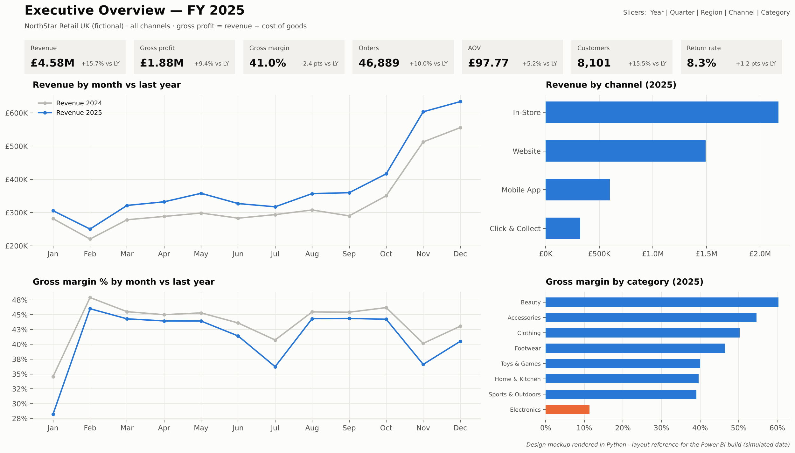
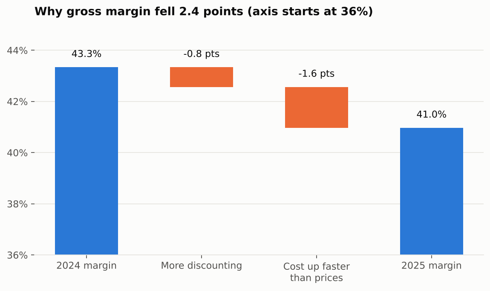
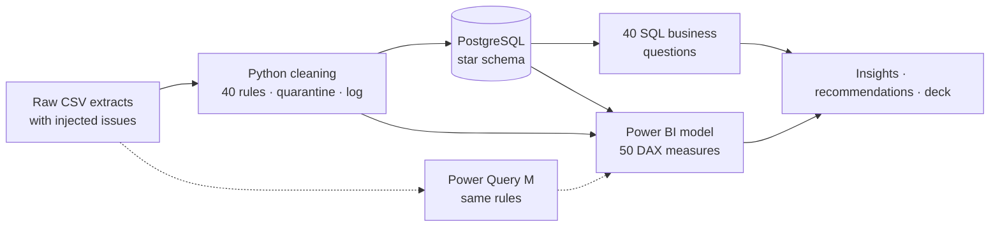

# UK Retail Sales & BI Dashboard: NorthStar Retail UK

> ⚠️ **Simulated portfolio project.** NorthStar Retail UK is a fictional company and every record is synthetic, generated
> by `scripts/01_generate_data.py`. Nothing here represents a real client, employer or financial result.

**Question:** *Revenue is growing, so why isn't profit keeping up, and what should management do?*

**Stack:** PostgreSQL · SQL · Python (pandas) · Excel · Power Query (M) · Power BI · DAX · Git


*Layout mockup rendered from the data in Python. See `powerbi/01_build_guide.md` to build the Power BI report.*

## Key findings

| | 2024 | 2025 | Change |
| --- | ---: | ---: | ---: |
| Revenue | £3.96M | £4.58M | **+15.7%** |
| Gross profit | £1.72M | £1.88M | **+9.4%** |
| Gross margin | 43.3% | 41.0% | **−2.4 pts** |

1. **Margin squeeze:** −1.6 pts from supplier costs rising faster than prices, −0.8 pts from more discounting.
2. **Electronics** is 19% of revenue but 6% of gross profit, and **sells below cost at discounts above 18.7%**.
3. **Deep discounts don't pay:** 30%+ discounts earned only 14% margin on £406K of 2025 revenue.
4. **Online apparel returns rose from ~16% to ~27%**, driven by one footwear brand's sizing (Stride Lab, 10% → 28%).
5. **Two stores** run margins far below the pack. Newcastle discounts 3× more than its peers.
6. **Growth is digital** (app +49%); like-for-like stores grew only +5.3%.
7. **14% of customers = 50% of revenue**; 1,450 formerly loyal customers are "at risk".

→ Full report: [`insights/01_insight_report.md`](insights/01_insight_report.md) ·
Recommendations: [`insights/02_recommendations.md`](insights/02_recommendations.md) ·
Deck: [`presentation/NorthStar_Executive_Presentation.pptx`](presentation/NorthStar_Executive_Presentation.pptx)



## Architecture



**Star schema:** `FactSales` (grain: one order line, 185,858 rows) and `FactReturns` (14,120 rows) share six dimensions:
Date, Customer, Product, Store, Region, Channel. → [`documentation/data_model.md`](documentation/data_model.md)

## Repository map

| Folder | Contents |
| --- | --- |
| [`business-analysis/`](business-analysis/01_business_case.md) | Problem statement, objectives, scope, stakeholder map, KPI definitions |
| [`scripts/`](scripts) | `01` generate data → `02` inject quality issues → `03` clean & model → `04` charts → `05` Excel → `06` deck · `run_pipeline.sh` |
| `data/` | `raw_data.zip`, `clean_data.zip` (or rebuild with the pipeline), injected-issue answer key, cleaning log |
| [`documentation/`](documentation) | Data dictionary, data model, validation rules, data-quality report (before/after), quality scorecard |
| [`sql/`](sql/README.md) | Schema with constraints, load, 13 data checks, **40 business questions with results and interpretation** |
| [`excel/`](excel/README.md) | Workbook: XLOOKUP, INDEX/MATCH, SUMIFS, COUNTIFS, conditional formatting, raw-data checks, reconciliation |
| [`power-query/`](power-query/README.md) | M scripts applying the same cleaning rules in Power BI / Excel |
| [`powerbi/`](powerbi/01_build_guide.md) | Click-by-click build guide for the 5 pages, theme file |
| [`dax/`](dax/README.md) | 50 measures + explanations (CALCULATE, FILTER, SUMX, ALL, USERELATIONSHIP, time intelligence) |
| [`insights/`](insights) | 10 insights (Finding → Evidence → Cause → Impact → Recommendation → Outcome), prioritised recommendations |
| [`presentation/`](presentation) | 10-slide executive deck |
| [`screenshots/`](screenshots) | Charts and dashboard page mockups |
| [`notes/`](notes/00_START_HERE.md) | **Study notes for every phase** + interview question bank |
| [`portfolio/`](portfolio/case_study_cv_linkedin.md) | Case study, CV bullets, LinkedIn post |

## Reproduce it

```bash
pip install pandas numpy matplotlib openpyxl python-pptx
createdb northstar                     # PostgreSQL 14+
bash scripts/run_pipeline.sh           # generate → break → clean → load → checks → zip
psql -d northstar -f sql/04_business_questions.sql
python scripts/04_build_charts.py && python scripts/05_build_excel.py && python scripts/06_build_presentation.py
```
The generator is seeded, so every run produces identical data. **Reconciliation totals:** revenue £8,545,887.73 ·
gross profit £3,595,003.75 · orders 89,528.

## Data quality at a glance

| Check | Before | After |
| --- | ---: | ---: |
| Sales validity | 91.7% | 100% |
| Channel / category labels | 14 / 28 | 4 / 8 |
| Duplicate sales rows / customers | 900 / 180 | 0 / 0 |
| Sales rows quarantined | n/a | 90 (0.05%) |
| Cleaned lines matching the answer key | n/a | 100% |

## Limitations
- Synthetic data: the patterns were designed to be realistic, but they are not observations of a real business.
- Gross profit only (no overheads, staff, rent, marketing or delivery costs).
- Refunded goods are assumed not to be resold (conservative).
- No inventory data, so the optional inventory page is not built.
- Power BI must be built on Windows following the guide; the images here are Python mockups until replaced with real screenshots.
- Benefit figures are illustrative estimates with stated assumptions.
