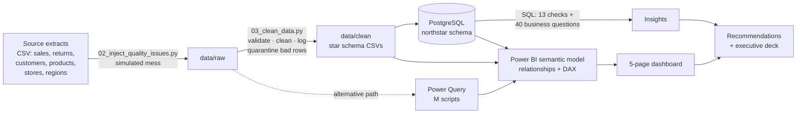
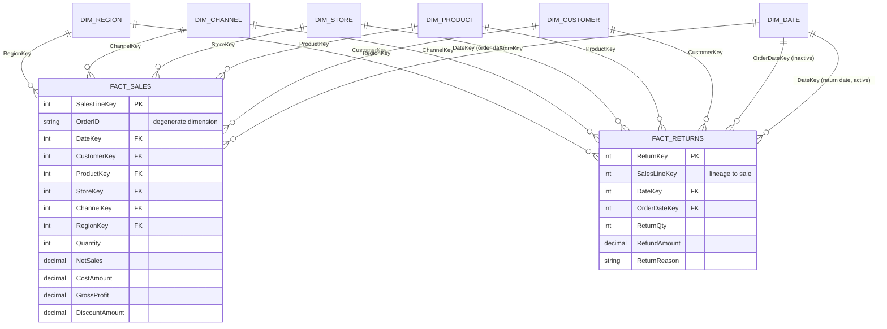

# Data Model — Star Schema (Phases 2 & 8)

## Architecture: from raw files to dashboard

## The star schema

Two fact tables share the same dimensions. This is sometimes called a **fact constellation** or **galaxy schema**:
still a star schema, but with more than one fact table.

## Grain (the most important design decision)

| Table | Grain: one row = | Rows |
| --- | --- | ---: |
| FactSales | one product line within one order | 185,858 |
| FactReturns | one returned order line | 14,120 |
| DimDate | one calendar day, 1 Jan 2024 – 31 Dec 2025 (no gaps) | 731 |
| DimCustomer | one de-duplicated customer + 1 "Guest" member | 12,501 |
| DimProduct | one SKU | 1,220 |
| DimStore | one store (24 physical + the e-commerce hub) | 25 |
| DimRegion | one UK region (ITL1 level) | 12 |
| DimChannel | one sales channel | 4 |

The line grain was chosen because it is the lowest level the source provides. Orders, products and customers can all be
rolled up from it, but you can never go *down* from an order-level table to product level.

## Keys

- **Surrogate keys** (`ProductKey`, `CustomerKey`, …): integers created during cleaning. They are small and fast to join,
  and they don't change if the source system re-codes a SKU.
- **Business keys** (`SKU`, `CustomerID`, `StoreCode`) are kept in the dimension for traceability.
- **DateKey** is a smart key `YYYYMMDD`, readable and sortable.
- **OrderID** stays on the fact as a *degenerate dimension*: an attribute with no table of its own, used to count orders.
- **Unknown member:** `CustomerKey = -1` "Guest" for anonymous in-store sales, so every fact row has a valid FK
  (no blanks in slicers, no lost rows in INNER JOINs).

## Relationships & cardinality (Power BI)

| From (many) | To (one) | Cardinality | Cross-filter | Active |
| --- | --- | --- | --- | --- |
| FactSales[DateKey] | DimDate[DateKey] | Many-to-one | Single | ✅ |
| FactSales[CustomerKey] | DimCustomer[CustomerKey] | Many-to-one | Single | ✅ |
| FactSales[ProductKey] | DimProduct[ProductKey] | Many-to-one | Single | ✅ |
| FactSales[StoreKey] | DimStore[StoreKey] | Many-to-one | Single | ✅ |
| FactSales[ChannelKey] | DimChannel[ChannelKey] | Many-to-one | Single | ✅ |
| FactSales[RegionKey] | DimRegion[RegionKey] | Many-to-one | Single | ✅ |
| FactReturns[DateKey] | DimDate[DateKey] | Many-to-one | Single | ✅ (return date) |
| FactReturns[OrderDateKey] | DimDate[DateKey] | Many-to-one | Single | ❌ inactive, used with `USERELATIONSHIP` |
| FactReturns[CustomerKey / ProductKey / StoreKey / ChannelKey / RegionKey] | each dimension | Many-to-one | Single | ✅ |

**Not** created: FactReturns → FactSales. Fact-to-fact relationships cause ambiguity and many-to-many problems. Both
facts reach each other *through* shared dimensions instead. `SalesLineKey` stays on FactReturns only for SQL lineage.

## Design decisions to explain in interviews

1. **Why RegionKey is on the fact, not only on the store.**
   Online orders are fulfilled by the e-commerce hub, which has no real region. The *sales region* is therefore the store's
   region for in-store and Click & Collect, and the customer's delivery region for website/app orders. Putting
   `RegionKey` on the fact gives one clear filter path. `DimStore[StoreRegion]` is kept only as a descriptive text, and
   there is **no** Store→Region relationship, so there is no second path for the filter to take (no ambiguity).

2. **Why one Date table with two relationships to returns.**
   A return has a return date and an original order date. Power BI allows only one *active* relationship between two
   tables, so return date is active (refunds by the month they happen) and order date is inactive, switched on in
   DAX with `USERELATIONSHIP` for the "return rate by order cohort" measure.

3. **Why single-direction filters.** Dimensions filter facts, never the reverse. Bi-directional filters make results
   hard to predict and slow the model.

4. **Why a dedicated Date dimension.** DAX time intelligence (YTD, previous year) needs a complete, contiguous date
   table marked as a date table. It also holds business calendar attributes (UK financial year, bank holidays,
   trading periods such as Black Friday week) that can't come from the fact table.

5. **Why customer PII is not in the model.** Names, email, full date of birth and full postcode are dropped. Only
   `AgeBand` and `PostcodeDistrict` remain: **GDPR data minimisation**. Analysts don't need to know who someone is to
   analyse behaviour.

6. **Why measures are calculated, not stored, for ratios.** Margin %, AOV and return rate are DAX measures, because a
   ratio must be computed *after* aggregation (SUM(profit)/SUM(revenue)), never summed or averaged across rows.

## How the model prevents wrong numbers

| Risk | Prevention |
| --- | --- |
| Double counting | Clear grain; duplicates removed and `UNIQUE(order_id, line)` enforced |
| Lost rows in joins | Unknown member (-1) instead of NULL foreign keys |
| Ambiguous filter paths | No Store→Region link; no fact→fact link; single direction |
| Wrong time intelligence | Contiguous DimDate marked as date table |
| Averaging ratios | Ratios only as DAX measures using DIVIDE |
| Mismatched totals | SQL reconciliation total = Power BI card (see `sql/README.md`) |
